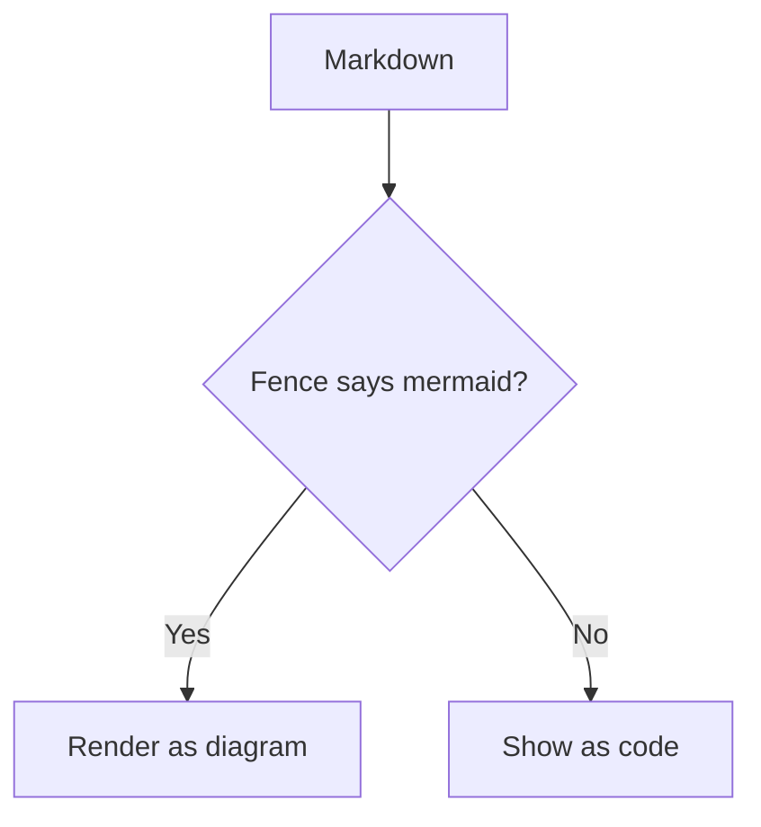

# Markdown feature test

A single note exercising every markdown feature the wiki renderer supports: frontmatter, headings, emphasis, rules, quotes, lists, tasks, tables, code, wikilinks, mermaid diagrams, links and images. Paragraphs join across line breaks — this line and the next
collapse into one paragraph with **bold**, __bold underscores__, *italic*, _italic underscores_, and `inline code`.

## What this wiki supports

- Frontmatter (YAML between `---` lines, stripped from the output)
- Headings `#` through `######`
- Emphasis: `**bold**`, `__bold__`, `*italic*`, `_italic_`, `inline code`
- Horizontal rules: `---`, `***`, `___`
- Blockquotes `>`, including nested blockquotes
- Lists: unordered `-`, `*`, `+`; ordered `1.`; task lists `- [ ]` / `- [x]` (rendered as checkboxes)
- Tables with `---`, `---:`, `:---:` alignment
- Fenced code blocks with an optional language tag: VS Code-dark highlighting for `python/js/ts/jsx/tsx/c/cpp/h/sh/bash/shell/zsh/json/yaml/yml`, plus a copy button; untagged fences render plain
- Mermaid diagrams: fences tagged `mermaid` render as dark, centered diagrams — never as code
- Links: external, mailto, and internal markdown links
- Wikilinks: a bare note name (must be unique across notes) or `path/to/note.md` plus an alias — both forms are demonstrated in Links below
- Images degrade to alt text
- HTML comments are skipped

Not rendered: math (`$…$` and `$$…$$`).

## Headings

### Level three

#### Level four

##### Level five

###### Level six

## Emphasis

**bold with asterisks**, __bold with underscores__, *italic with asterisks*, _italic with underscores_, and `inline code` mixed with **bold** and *italic*.

## Horizontal rules

Three equivalent forms:

---

***

___

## Blockquotes

> A blockquote paragraph with **bold** and `code`.
>
> A second paragraph in the same quote.
> > A nested quote.

## Unordered lists

- alpha
- beta
* gamma
+ delta

## Ordered lists

1. first
2. second
3. third

## Task lists

- [x] done
- [X] also done (uppercase X)
- [ ] open

## Tables

| Name | Value | Alignment |
| --- | ---: | :---: |
| alpha | 1 | left |
| beta | 2 | right |
| gamma | 3 | center |

## Code blocks

Fenced with a language:

```python
def seek(t):
    name = "frame"  # a string
    scale = 1.5
    return frame_at(t)  # pure function of alpha
```

Plain fence:

```
no language tag
```

## Mermaid diagrams



## Links

- external: [GitHub](https://github.com)
- mailto: [send mail](mailto:someone@example.com)
- internal markdown link: [back to index](index.md)
- bare wikilink: [[shortcut-matrix]]
- wikilink with path and alias: [[appendix/sparse/shortcut-matrix.md|shortcut matrix]]

<!-- HTML comments are skipped by the renderer. -->

## Images


